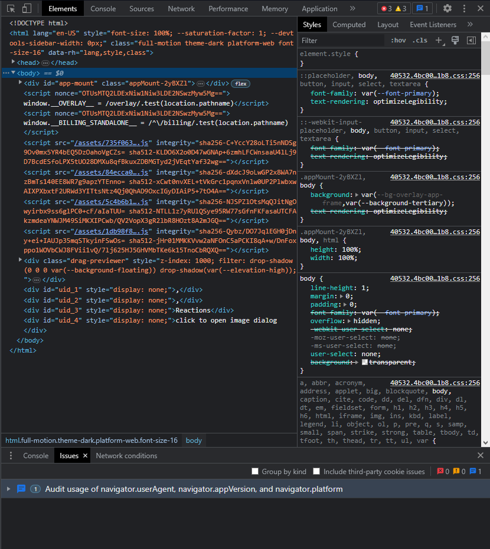
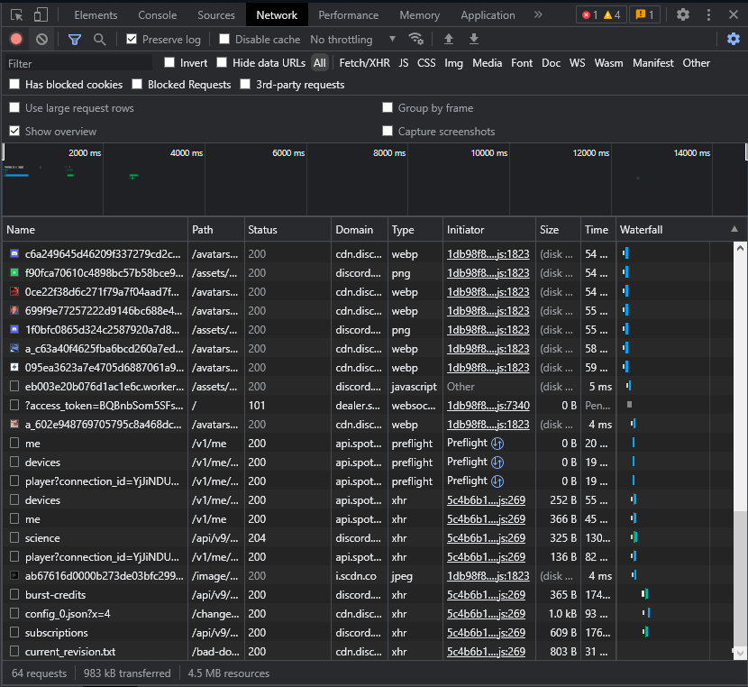
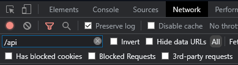
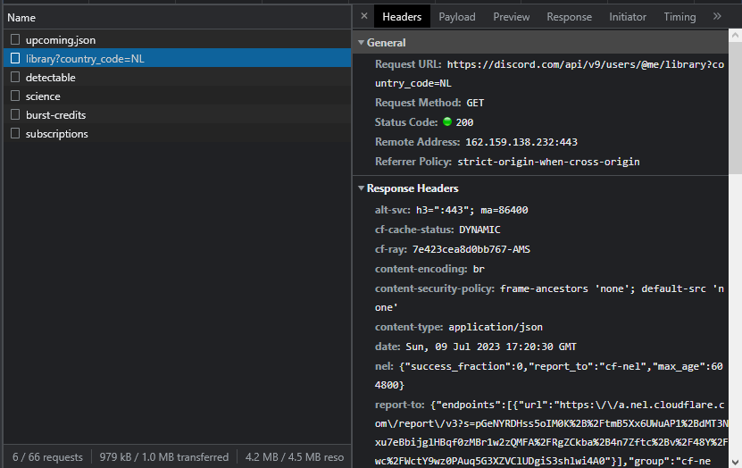
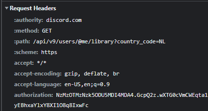

# Getting your token

### Step 1

Log into your Discord account on the [Discord website](https://discord.com/login). Make sure to use the website and not the Desktop app.

### Step 2

Press `Ctrl` + `Shift` + `I` on your keyboard to open the Developer Tools. If you're on a Mac, press `Cmd` + `Opt` + `I`. You should see a window like this:

### Step 3

Click on the `Network` tab at the top of the Developer Tools window. If you don't see it, click on the `>>` icon to show more tabs. You should see a window like this:

### Step 4

Write `/api` in the filter box at the top left of the Network tab, like this:

### Step 5

You should see a couple of entries in the Network tab. Click on one that says `library` or `subscriptions` in the `Name` column. If you don't see any entries, refresh the page and try again. You should see a popup with a couple of tabs. Click on the `Headers` tab. You should see a window like this:

### Step 6

Scroll down until you see a section called `Request Headers`. You should see a line that says `authorization` with a long string of letters and numbers next to it. This is your token. It should look something like this:

Right click on the token and click `Copy value`. **Do not share this token with anyone!** If someone gets your token, they can log into your account and do anything they want with it. If you think someone has your token, you must change your password immediately.

---

Now that you have your token, you can continue to the next page to learn how to get a license key and install LightningBot.