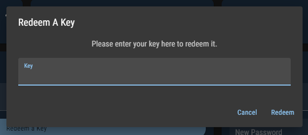

# License keys

### Obtaining a license key

To use LightningBot, you'll require a license key. You can obtain one by purchasing it on the dashboard. You can make payments using PayPal on the dashboard or cryptocurrencies through our [Sellix store](https://lightning-bot.mysellix.io/product/63cc61ba7c722). Here's what you should be aware of:

- When paying with PayPal, your license key is automatically redeemed on your account.
- If you choose to pay with Sellix, you'll need to redeem the key manually on the dashboard.

:::info
You don't need to have a PayPal account to use PayPal for payment. Depending on your location, you can also use various payment methods via PayPal, including credit card, Venmo, Bancontact, BLIK, eps, giropay, iDEAL, MyBank, Przelewy24, and Sofort.
:::

:::tip Free Trial
For a test run, LightningBot offers a 7-day free trial. To initiate your free trial, proceed to the next page and follow the installation instructions. Your free trial will automatically activate the first time you start LightningBot.
:::

:::tip Giveaways
To stand a chance at winning a free license key, join our Discord server and participate in our giveaways.
:::

### Redeeming a License Key

If you've acquired a license key via our Sellix store, won it in a giveaway, or obtained it through any other means, you'll need to redeem it manually. Here's how to do it from the [dashboard](https://lightning-bot.com/dashboard):

1. Click the `Redeem a key` button within the `Key` card.

2. You should see a popup like the one below:
   
   

3. Enter your license key in the provided input field.

4. Click the `Redeem` button.

If your license key is valid, it will be successfully redeemed on your account, granting you access to LightningBot. Should you encounter any difficulties while redeeming your license key, please reach out to us on [Discord](https://lightning-bot.com/discord).

Now that you have a valid license key or have chosen to use the free trial, you can proceed to the next page for instructions on installing LightningBot.
