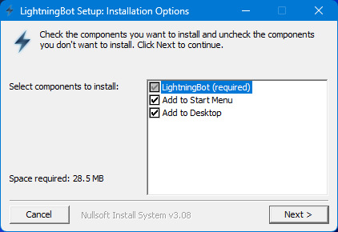
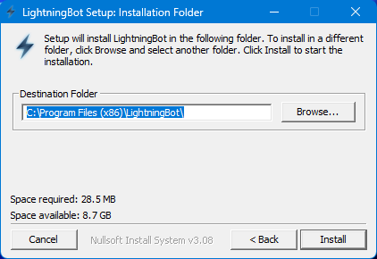
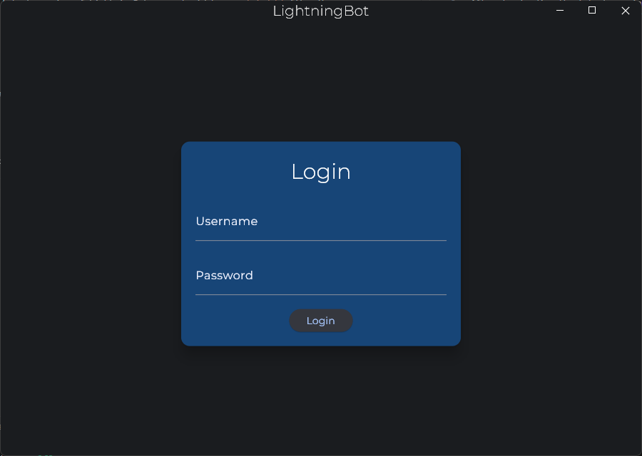

# With UI

Once you've downloaded the latest version of LightningBot, follow these steps to initiate the installation process:

1. Double-click the downloaded `ui.exe` file. The installation will start, and you'll encounter the following screen:

2. Here, you can choose whether you want LightningBot to be added to your Start Menu and Desktop. Make your selections, then click `Next` to proceed. You'll then see the following screen:

3. Select the folder where you want LightningBot to be installed. The default location is `C:\Program Files (x86)\LightningBot`. After making your choice, click `Install` to start the installation process.

4. Upon completion of the installation, click `Close`. You can now launch LightningBot from your Start Menu, Desktop, or by using the Windows search bar. You should see the following screen:

Now that you've successfully installed LightningBot, you can proceed to the [Setting Up](/setting-up/ui) page for further instructions.
