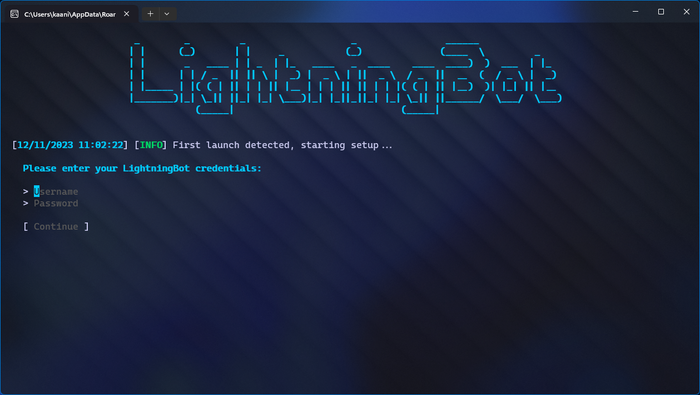

# With Console

For the console version of LightningBot on Windows, follow these steps after downloading the latest version:

1. Double-click the downloaded `selfbot.exe` file. This action will launch a console window, which should look like this:

   

You can now proceed to the [Setting Up](/setting-up/console) page to configure and set up LightningBot.
