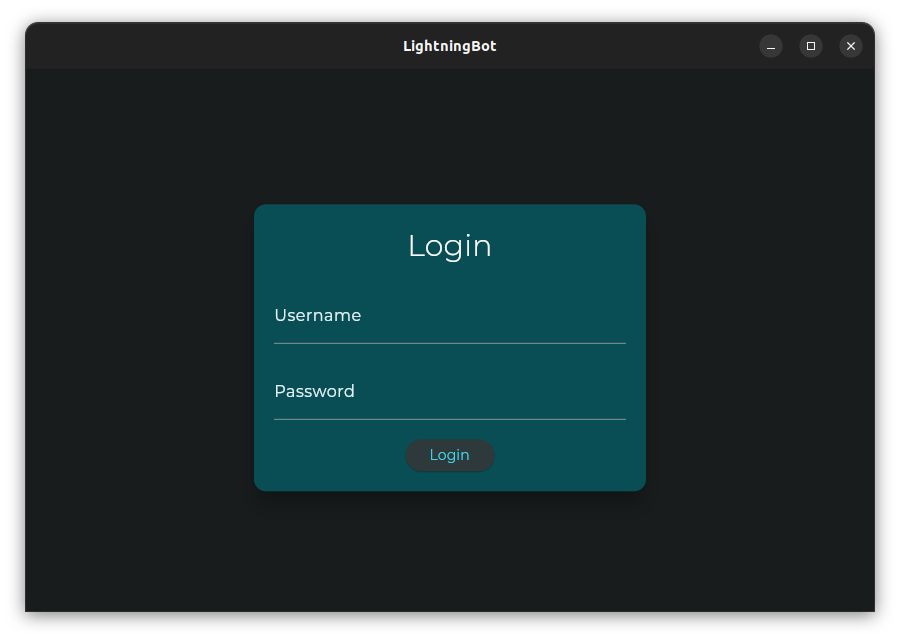

# With UI

After downloading the latest version of LightningBot, you should have a `ui.deb` file. Install this file by executing the following command in the directory where the file is located:

```bash	
sudo dpkg -i ui.deb
```

:::note
Alternatively, you can install the `ui.deb` file using a package installer like GDebi.
:::

Following the installation, you should be able to launch LightningBot from your applications menu. You should see the following screen:



Now that you have successfully installed LightningBot, you can proceed to the [Setting Up](/setting-up/ui) page for further setup instructions.
