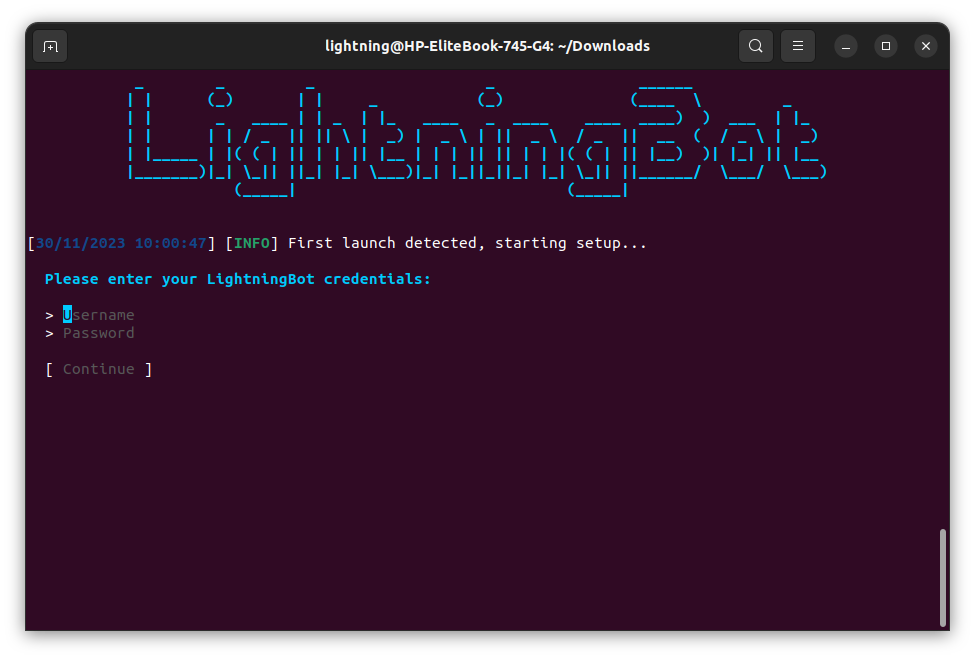

# With Console

After downloading the latest version of LightningBot, you should have a `selfbot` file. To run the console version, execute the following commands in the directory where the file is located:

```bash
chmod +x selfbot
./selfbot
```

A console window should appear, like this:



Now that you have successfully installed LightningBot, you can proceed to the [Setting Up](/setting-up/console) page for further setup instructions.
