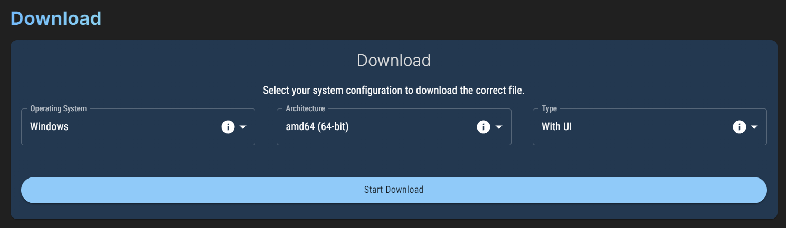

import DocCardList from '@theme/DocCardList';

# Installation

LightningBot is officially compatible with the following operating systems:

- Windows 10 and above
- Ubuntu 18.04 and above
- macOS Monterey and above

If you are using a different version or distribution of these operating systems, you may still be able to run LightningBot, but there might be compatibility issues. In case you encounter any problems, please don't hesitate to contact us on [Discord](https://lightning-bot.com/discord).

---

## Downloading the Files

On the [dashboard](https://lightning-bot.com/dashboard), when you scroll down, you'll come across a section labeled `Download`, as depicted below:

To proceed, follow these steps:

1. Select your operating system and architecture. If you're on Windows, you can identify your architecture by opening the `System Information` app and checking the `System Type` field. "x64" indicates 64-bit, and "x86" indicates 32-bit. For Linux, determine your architecture by executing `uname -m` in a terminal. On macOS, there's no need to select an architecture, as the Intel and Apple Silicon versions are bundled together.

2. Next, choose your preferred type: one with a user interface or one with a console.

3. Click the `Start Download` button to begin the download.

---

## Installing LightningBot

Please select your operating system below to receive detailed instructions on how to install LightningBot.

<DocCardList />