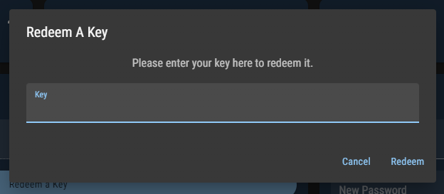

# License keys

### Getting a license key

To use LightningBot, you will need a license key. You can get one by purchasing it on the [dashboard](https://lightning-bot.com/dashboard). You can pay with PayPal or with cryptocurrencies through our [Sellix store](https://lightning-bot.mysellix.io/product/63cc61ba7c722). If you pay with PayPal, your license key will be automatically redeemed on your account. This is not the case with Sellix, so you will have to redeem it manually. You can find instructions on how to do this on the next page.

:::info
You don't need to have a PayPal account to pay with PayPal. Depending on your location, you can also use the following payment methods via PayPal: Credit card, Venmo, Bancontact, BLIK, eps, giropay, iDEAL, MyBank, Przelewy24 and Sofort.
:::

:::tip Free Trial
You can try LightningBot for free for 7 days! To start your free trial, you can continue to the next page and follow the installation instructions. The free trial will be automatically activated when you start LightningBot for the first time.
:::

:::tip Giveaways
Join our [Discord server](https://lightning-bot.com/discord) to participate in giveaways and get the chance to win a free license key.
:::

### Redeeming a license key

If you have purchased a license key through our [Sellix store](https://lightning-bot.mysellix.io/product/63cc61ba7c722), won a giveaway or received a license key in any other way, you will have to redeem it manually. You can do this on the [dashboard](https://lightning-bot.com/dashboard) by pressing the `Redeem a key` button inside the `Key` card. You should see the following popup:

Enter your license key in the input field and press the `Redeem` button. If the license key is valid, it will be redeemed on your account and you will be able to use LightningBot. If the license key is invalid, you will see an error message. If you have any issues redeeming your license key, please contact us on [Discord](https://lightning-bot.com/discord).

---

Now that you have a license key or decided to use the free trial, you can continue to the next page to install LightningBot.