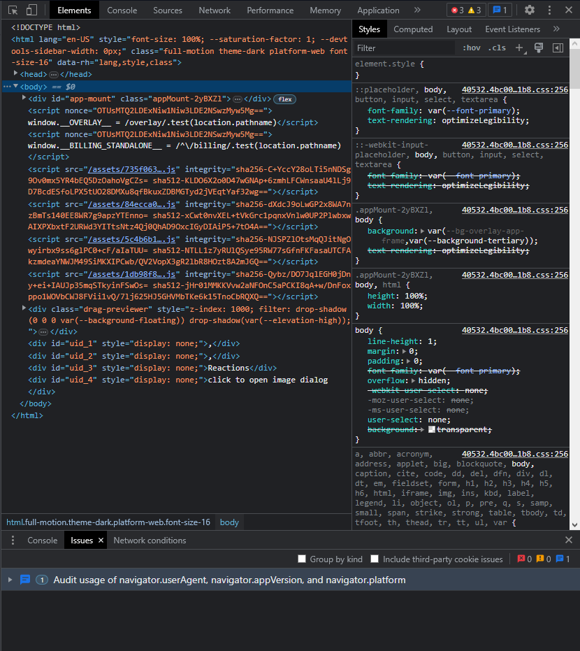
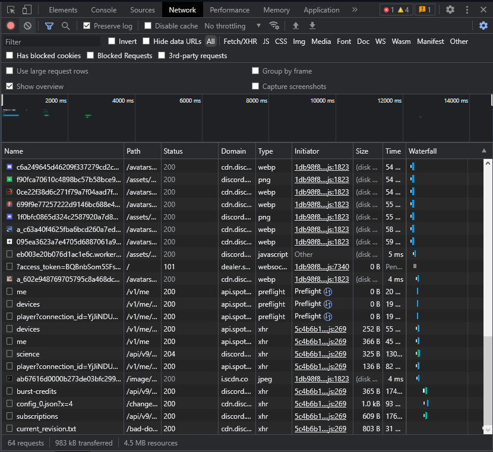
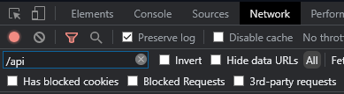
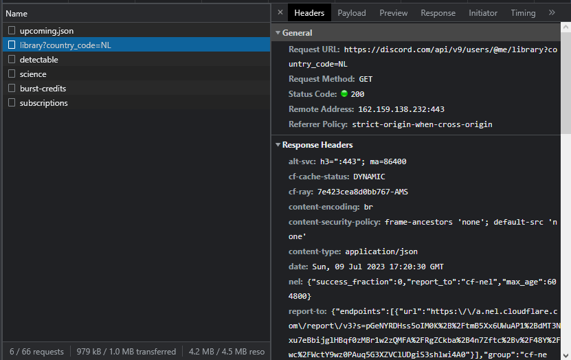
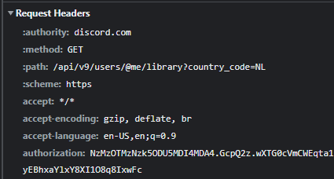

# Developer Tools

Follow these steps to obtain your token using the Developer Tools:

### Step 1: Log in to Discord

Log into your Discord account using the [Discord website](https://discord.com/login). Ensure that you use the website and not the Desktop app.

### Step 2: Open the Developer Tools

Press `Ctrl` + `Shift` + `I` on your keyboard to open the Developer Tools. If you're on a Mac, press `Cmd` + `Opt` + `I`. You should see a window like this:

### Step 3: Open the Network tab

Click on the `Network` tab at the top of the Developer Tools window. If you don't see it, click on the `>>` icon to reveal more tabs. You should see a window like this:

### Step 4: Filter the requests

Type `/api` in the filter box at the top left of the Network tab, like this:

### Step 5: View the headers

You should see several entries in the Network tab. Click on an entry that displays `library` or `subscriptions` in the `Name` column. If you don't see any entries, refresh the page and try again. You should see a popup with various tabs. Click on the `Headers` tab. It should resemble this:

### Step 6: Obtain your token

Scroll down until you find a section called `Request Headers`. You should see a line that says `authorization` with a lengthy string of letters and numbers adjacent to it. This is your token, and it should resemble something like this:

Right-click on the token and select `Copy value`. **Ensure that you do not share this token with anyone!** If someone obtains your token, they can access your account and perform unauthorized actions. If you suspect that someone has acquired your token, change your password immediately.

---

Now that you have your token, you can proceed to the next page to learn how to obtain a license key and install LightningBot.