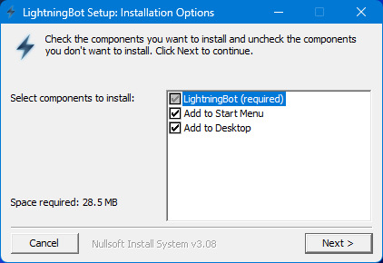
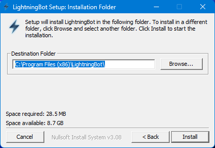
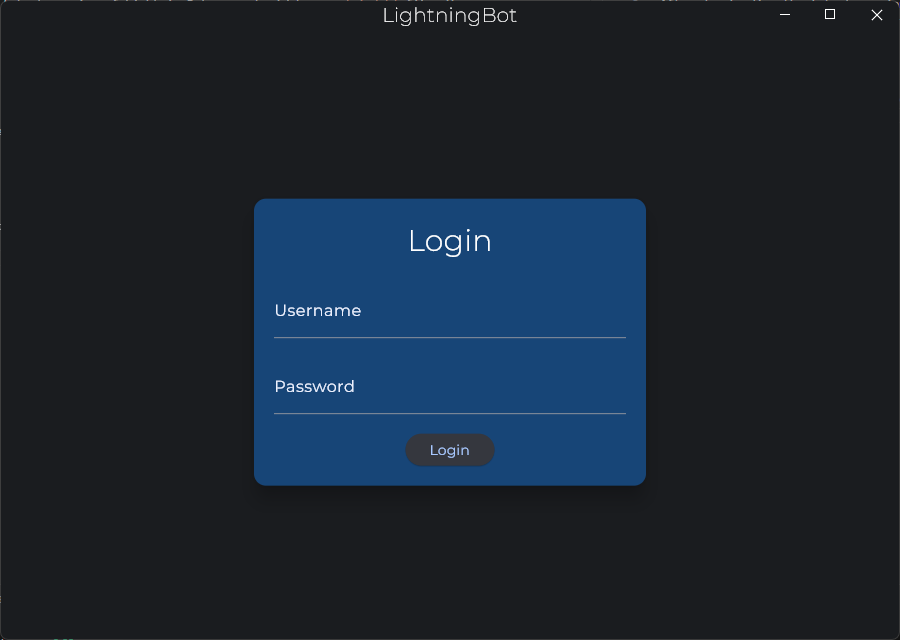

# With UI

After downloading the latest version of LightningBot, you can start the installation by double-clicking the downloaded `ui.exe` file. The installation will start and you should see the following screen:

You can select if you want LightningBot to be added to your Start Menu and Desktop here. Click `Next` to continue, and you will see the following screen:

Here you can select the folder where LightningBot will be installed. The default folder is `C:\Program Files (x86)\LightningBot`. Now click `Install` to start the installation. When the installation is complete, you can click `Close` and start LightningBot from your Start Menu, Desktop or by searching for it in the Windows search bar. You should see the following screen:

Now that you have installed LightningBot, you can continue to the [Setting Up](/category/setting-up) page.
