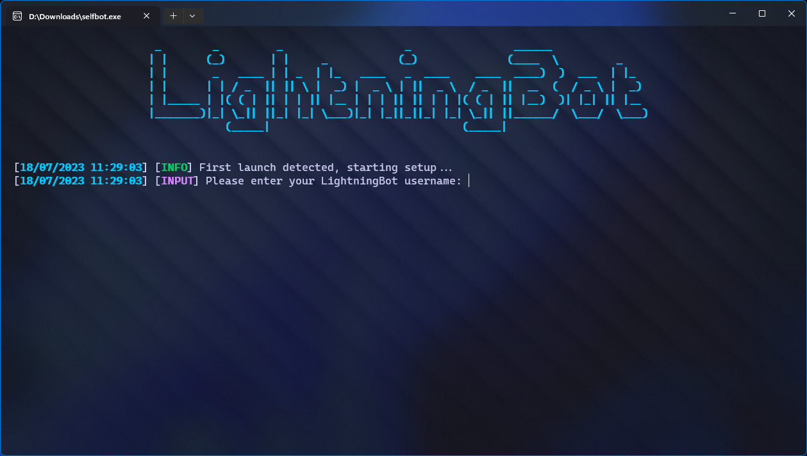

# With Console

After downloading the latest version of LightningBot, you can start the console version by double-clicking the downloaded `selfbot.exe` file. You will see a console window appear, like this:

You can now continue to the [Setting Up](/category/setting-up) page to set up LightningBot.
