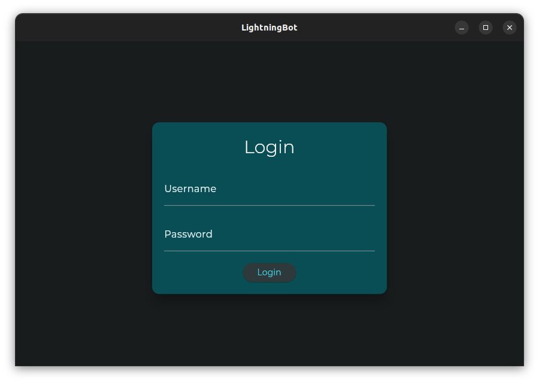

# With UI

After downloading the latest version of LightningBot, you should have a `ui.deb` file. You can install this file by running the following command in the directory where the file is located:

```bash	
sudo dpkg -i ui.deb
```

:::note
It's also possible to install the `ui.deb` file using a package installer like GDebi.
:::

You should now be able to start LightningBot from your applications menu. You should see the following screen:



Now that you have installed LightningBot, you can continue to the [Setting Up](/category/setting-up) page.
