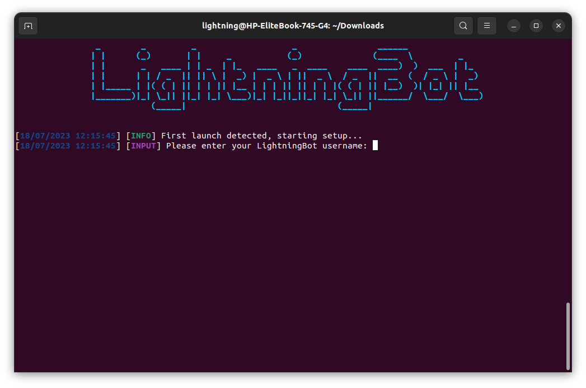

# With Console

After downloading the latest version of LightningBot, you should have a `selfbot` file. You can start the console version by running the following commands in the directory where the file is located:

```bash
chmod +x selfbot
./selfbot
```

You should now see a console window appear, like this:



You can now continue to the [Setting Up](/category/setting-up) page to set up LightningBot.
