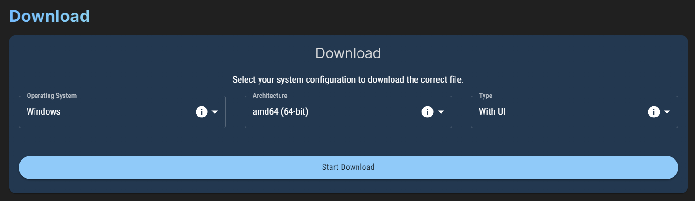

import DocCardList from '@theme/DocCardList';

# Installation

LightningBot officially supports Windows 10 and up, Ubuntu 18.04 and up, and macOS Monterey and up. If you are using a different version or distribution of these operating systems, you may still be able to run LightningBot, but you could run into issues. If you do, please contact us on [Discord](https://lightning-bot.com/discord).

---

## Downloading the files

When you scroll down on the [dashboard](https://lightning-bot.com/dashboard), you will see a section called `Download` like this:

Select your operating system and architecture. On Windows, you can find out your architecture by opening the `System Information` app and looking at the `System Type` field. `x64` means 64-bit, and `x86` means 32-bit. On Linux, you can find out your architecture by running `uname -m` in a terminal. On macOS, you won't need to select an architecture as the Intel and Apple Silicon versions are bundled together. Finally, select your preferred type (with a user interface or with a console) and click the `Start Download` button.

---

## Installing LightningBot

Select your operating system below to get further instructions on how to install LightningBot.

<DocCardList />