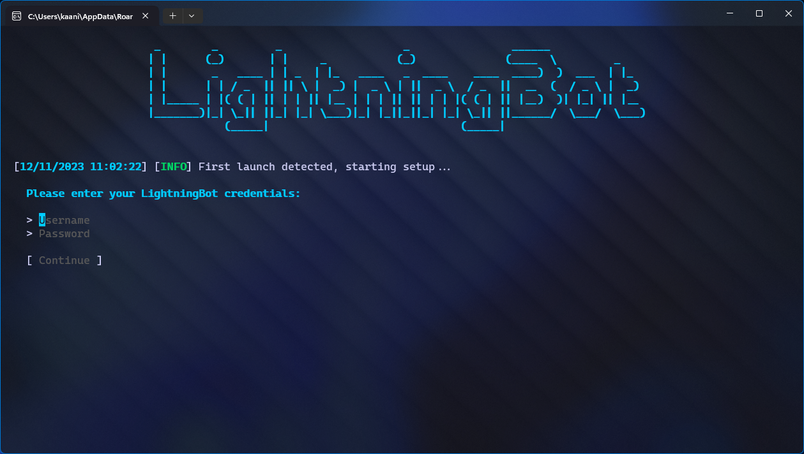
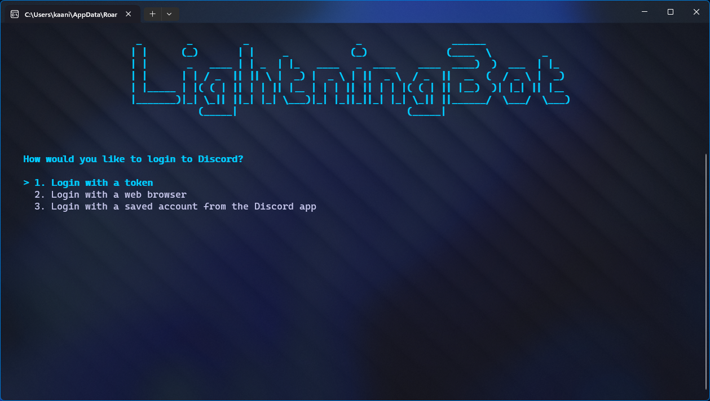
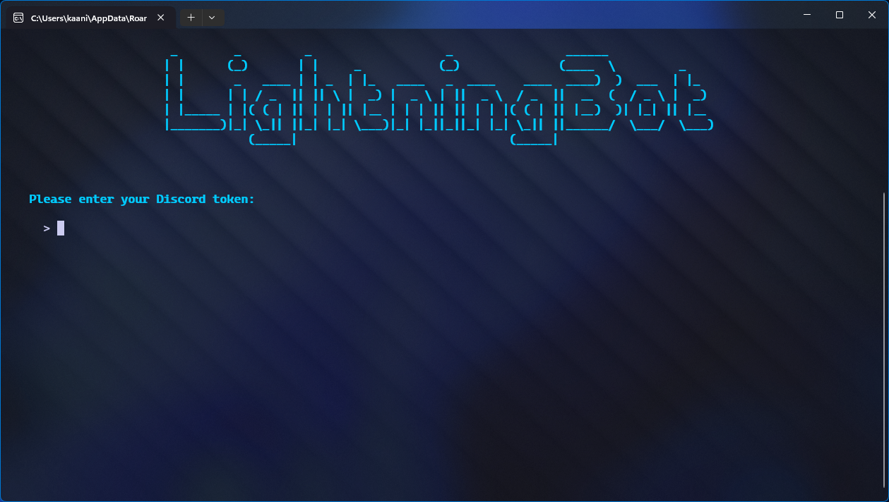
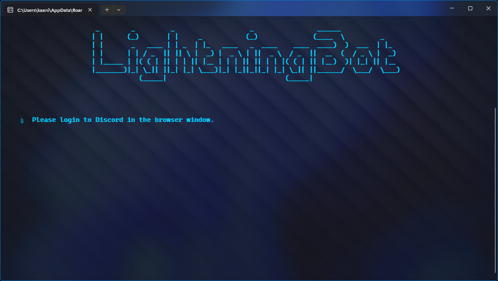
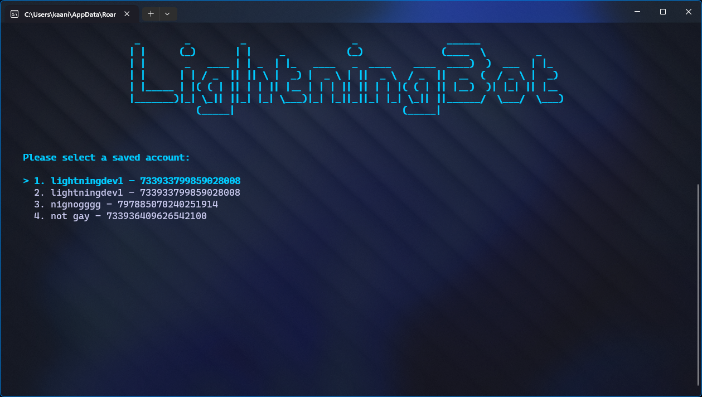
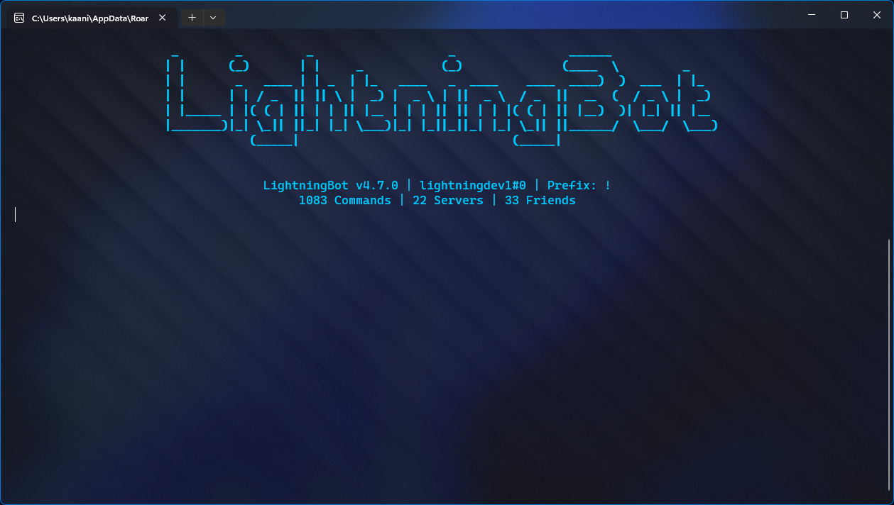

# Console

After following the installation instructions, you should see the following screen:

You should enter your LightningBot username and password here. You should now see the following screen after continuing:

---

### Login with a token

Select the `Login with a token` option. You should see the following screen:

Enter your Discord token here. The token will be saved and you will be logged in.

:::tip
You can find your Discord token by following the instructions [here](/getting-your-token).
:::

### Login with a web browser

Select the `Login with a web browser` option. You should see the following screen:

A browser window will open and you will be prompted to login to Discord. After logging in, your token will be saved and you will be logged in.

### Login with a saved account

Select the `Login with a saved account from the Discord app` option. After a few seconds, you should see the following screen:

Select the account you want to use. Your token will be saved and you will be logged in.

---

You should now see the following screen:

You are now logged in and can start using LightningBot. View the [Commands](/category/commands) or [Features](/category/features) pages to learn more about what you can do with LightningBot.