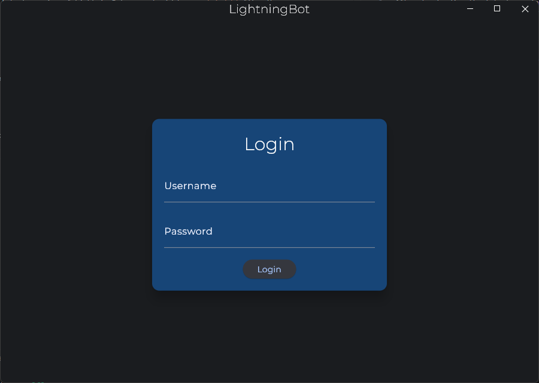
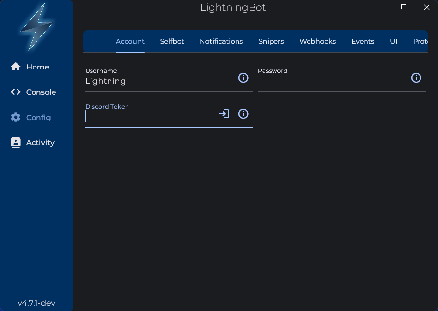
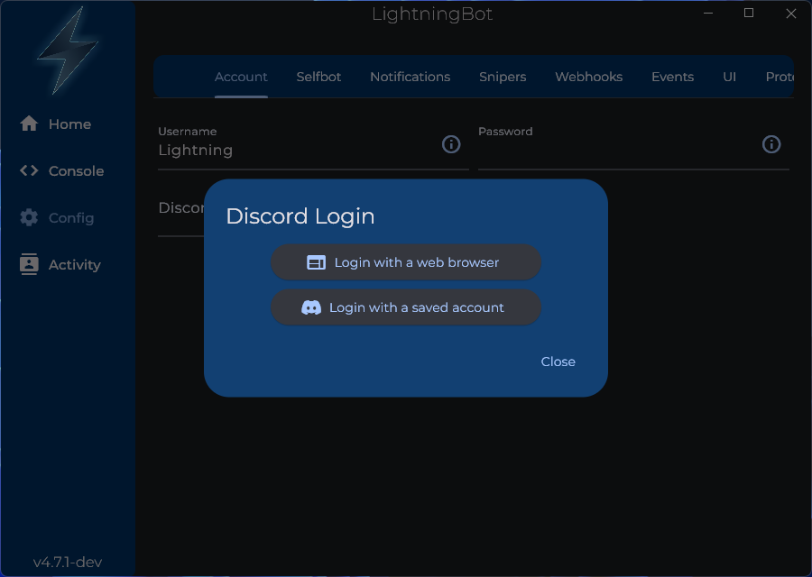
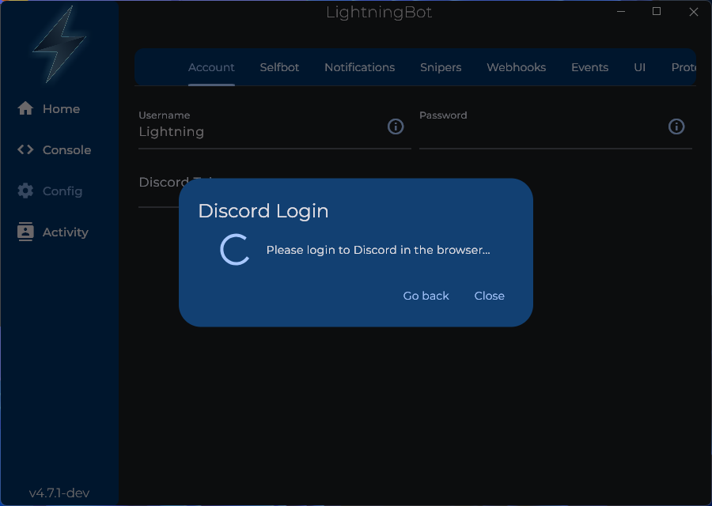
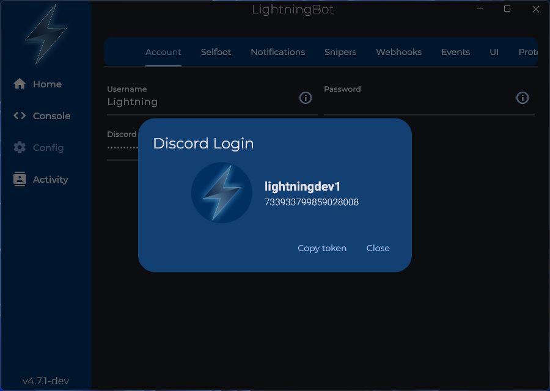
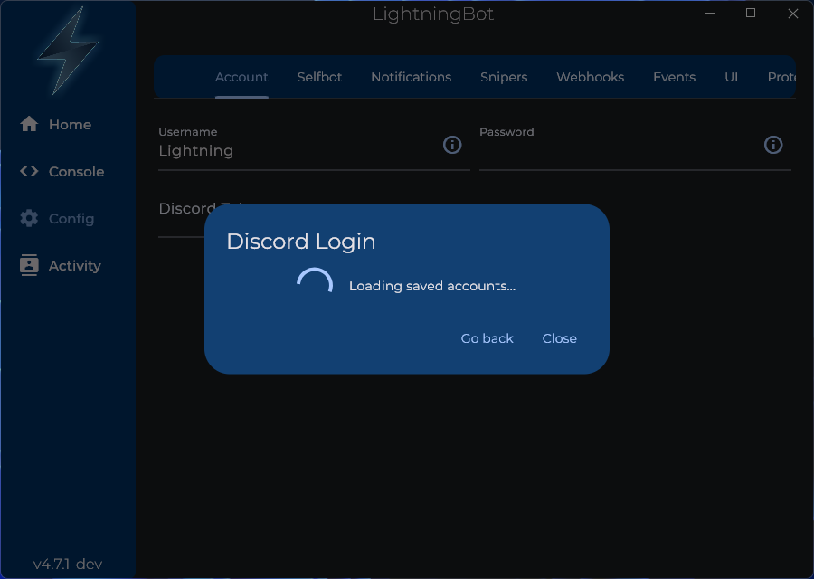
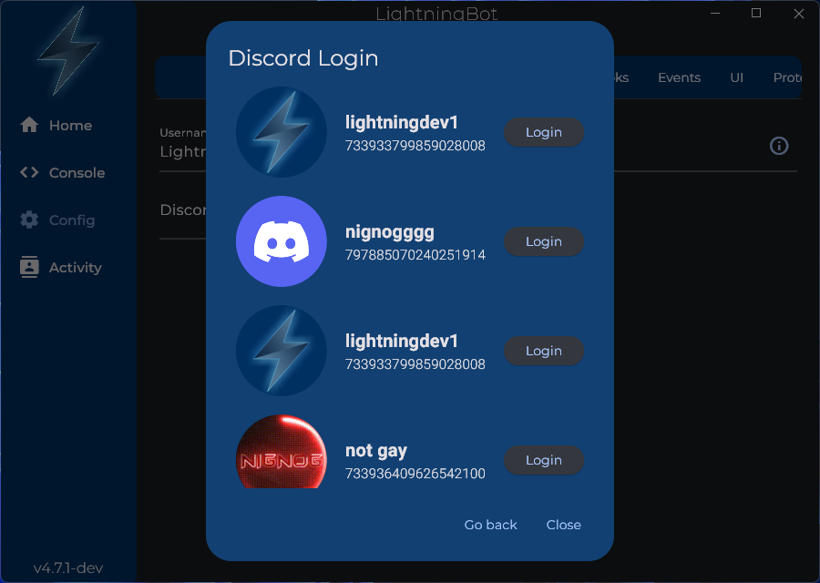
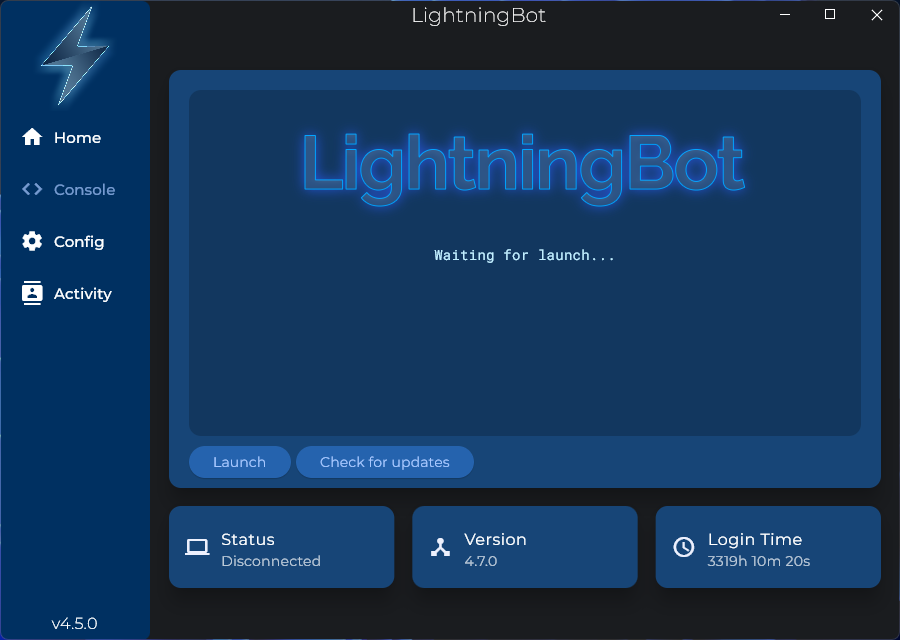

# UI

After following the installation instructions, you should see the following screen:

You should enter your LightningBot username and password here. You should now see the following screen:

Go to the `Config` page by clicking the `Config` button with the cog icon on the left of the window. You should see the following screen:

Here in the `Account` tab, there are three configuration options: Username, Password and Discord Token. If you already have your Discord token, you can enter it here. Otherwise, press the login icon on the right of the Discord Token field. You should see the following screen:

---

### Login with a web browser

Press the `Login with a web browser` button. You should see the following screen:

A web browser window will open. Enter your Discord credentials or scan the QR code and log in. You should see the following screen:

Your Discord token has now been saved. You can press the `Copy token` button to copy it to your clipboard if necessary.

### Login with a saved account

Press the `Login with a saved account` button. You should see the following screen:

After a few seconds, you should see the following screen:

Select the account you want to use and press the `Login` button. You should see the following screen:

Your Discord token has now been saved. You can press the `Copy token` button to copy it to your clipboard if necessary.

---

Now, go to the `Console` page. You should see the following screen:

Press the `Launch` button to start LightningBot. You should see the following screen after a few seconds:

You are now logged in and can start using LightningBot. View the [Commands](/category/commands) or [Features](/category/features) pages to learn more about what you can do with LightningBot.
