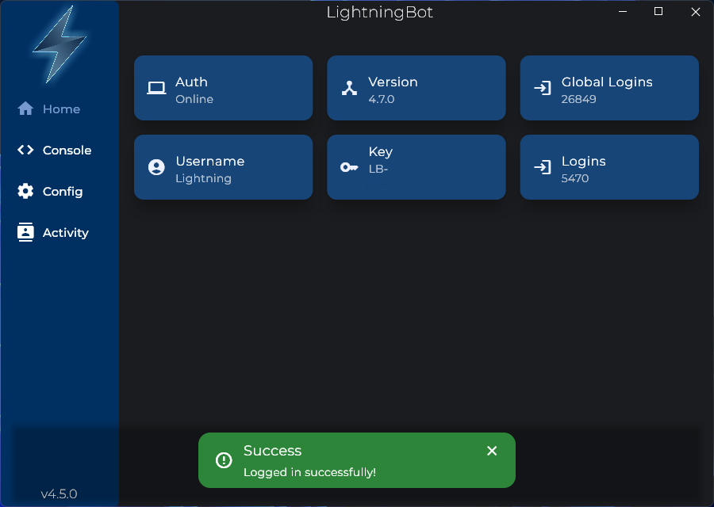
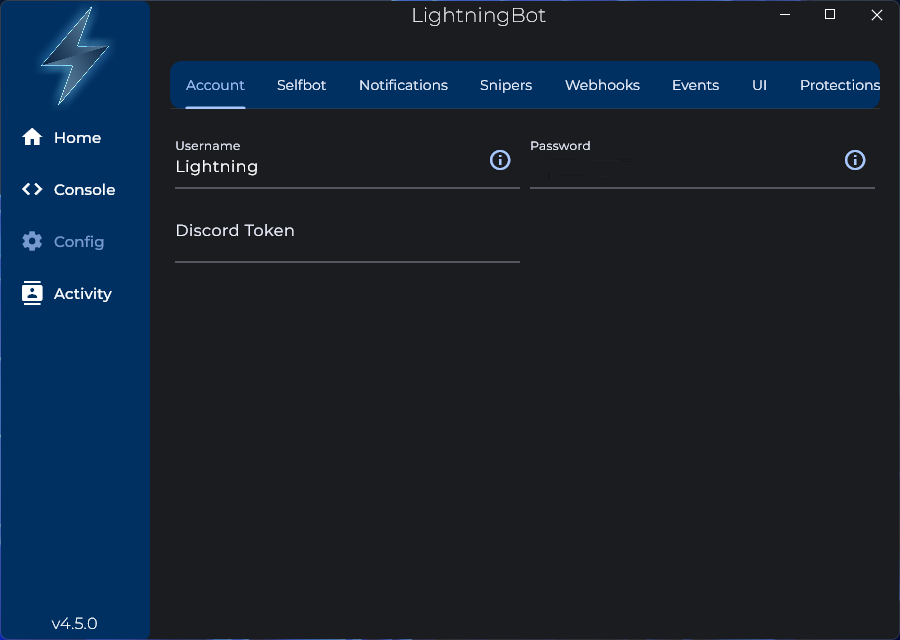
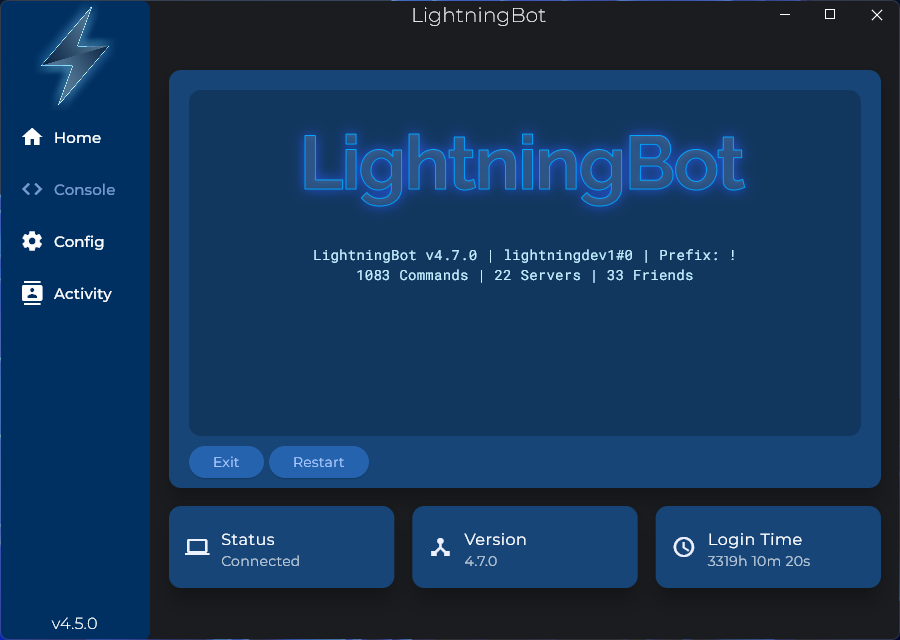

# UI

After following the installation instructions, you should see the following screen:

You should enter your LightningBot username and password here. You should now see the following screen:

Go to the `Config` page by clicking the `Config` button with the cog icon on the left of the window. You should see the following screen:

Here in the `Account` tab, there are three configuration options: Username, Password and Discord Token. You should enter your Discord token here. If you don't have your Discord token, check out the [Getting your token](/getting-your-token) page.

Now, go to the `Console` page. You should see the following screen:

Press the `Launch` button to start LightningBot. You should see the following screen after a few seconds:

You are now logged in and can start using LightningBot. View the [Commands](/category/commands) or [Features](/category/features) pages to learn more about what you can do with LightningBot.
