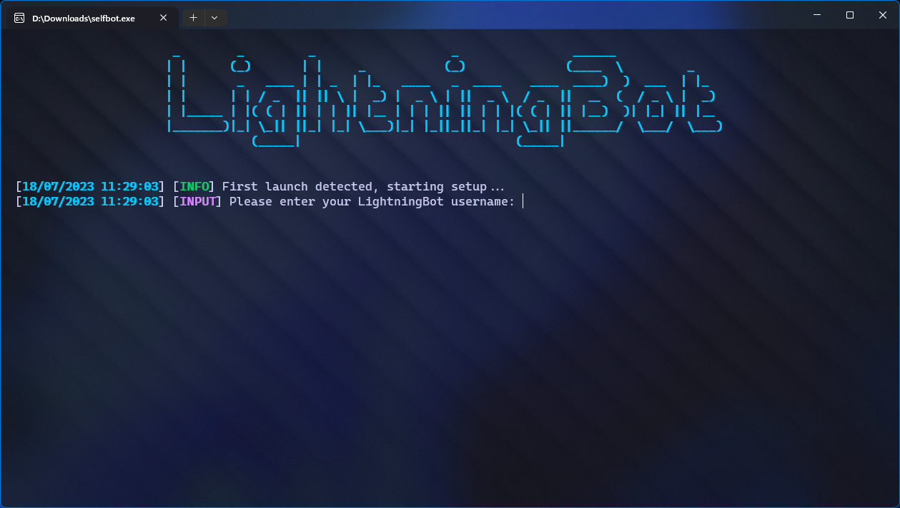
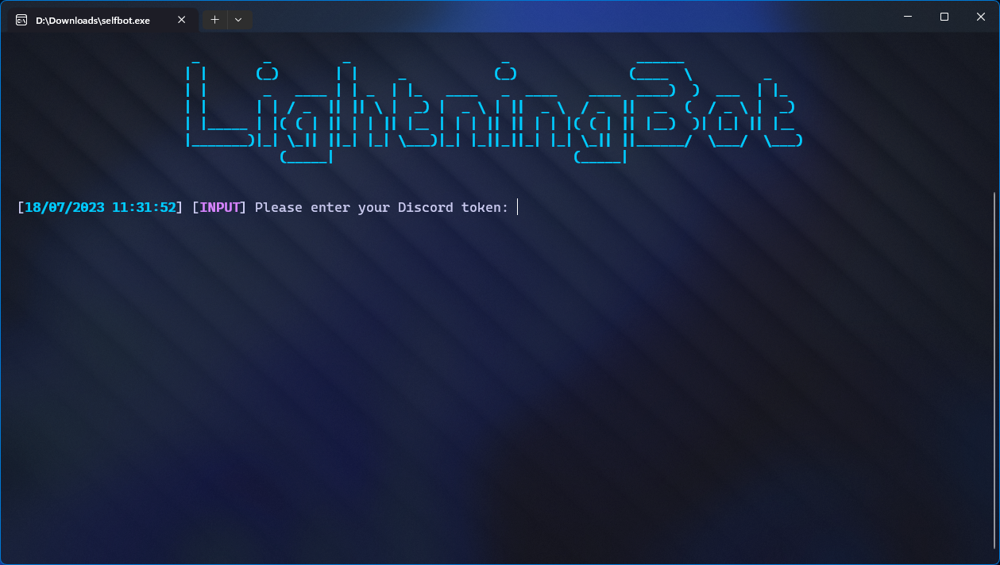
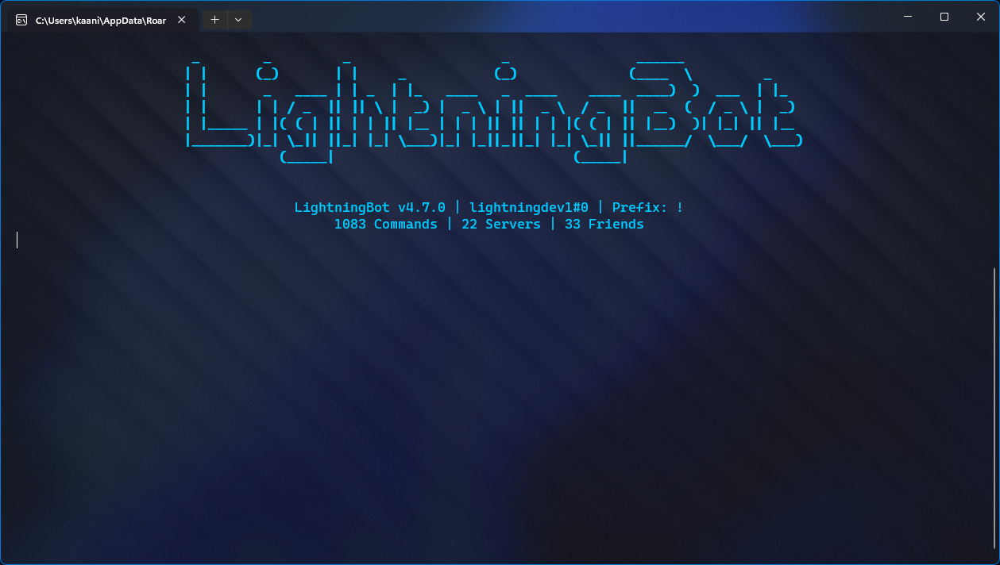

# Console

After following the installation instructions, you should see the following screen:

You should enter your LightningBot username and password here. You should now see the following screen:

You should enter your Discord token here. If you don't have your Discord token, check out the [Getting your token](/getting-your-token) page.

You should now see the following screen:

You are now logged in and can start using LightningBot. View the [Commands](/category/commands) or [Features](/category/features) pages to learn more about what you can do with LightningBot.