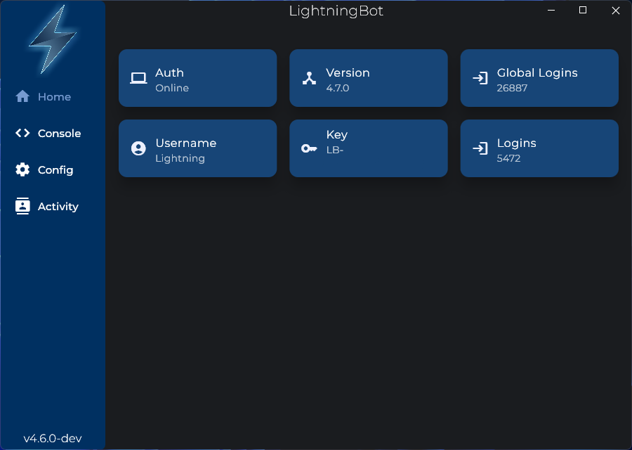
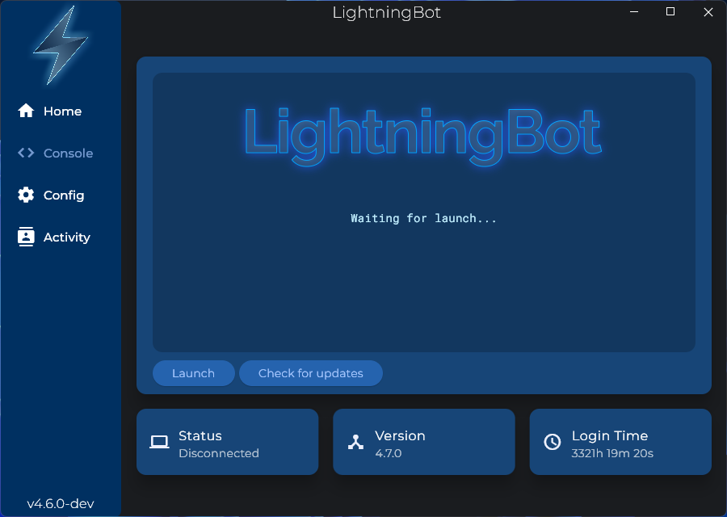
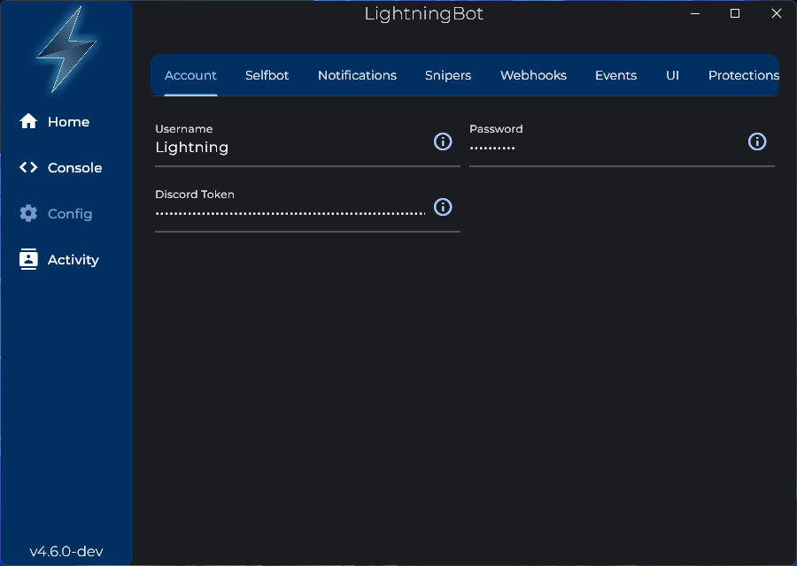
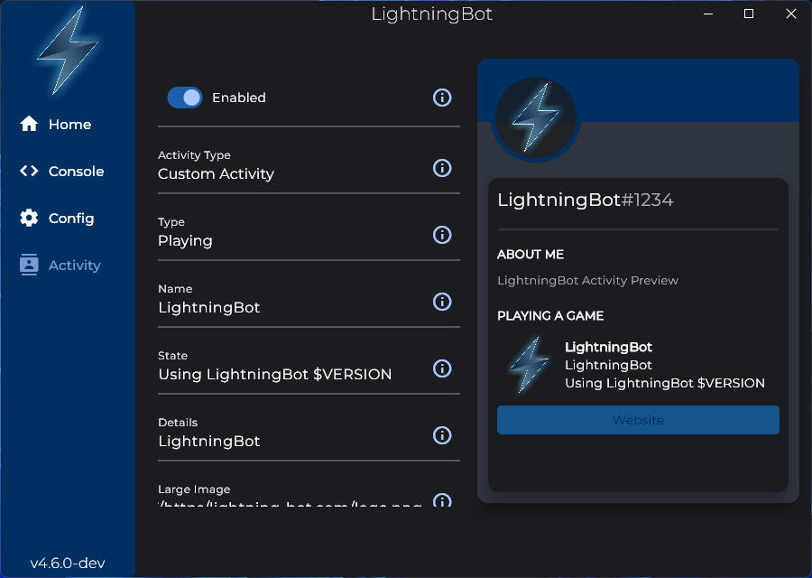

# UI

The UI (User Interface) is the graphical interface of LightningBot. You can use it to change your configuration settings, start and stop LightningBot, and view the console output.

:::note
It's not required to use LightningBot's UI. You can use the command line interface (CLI) instead by downloading the console version on the dashboard. For more information, go to the [Installation](/category/installation) section.
:::

## Home

The home page is the first page you see when you open the UI. It shows you some information about LightningBot and your LightningBot account.

## Console

The console page shows you the console output of LightningBot. You can use it to see what LightningBot is doing and to see if there are any errors.

You can also start and stop LightningBot from the console page. Click the `Launch` button to start LightningBot and click the `Exit` button to stop LightningBot (when it is running).

## Config

The config page can be used to change your configuration settings. There are multiple tabs, each containing a different set of configuration settings. Every config item has an information icon next to it. You can click this icon to see more information about the config item.

## Activity

On the activity page you can change your Custom Activity and RPC settings. See the [Activity](/commands/activity-commands) page for more information.

There is also an activity preview on the right of this page, so you can instantly see what your activity will look like when you change the settings.

