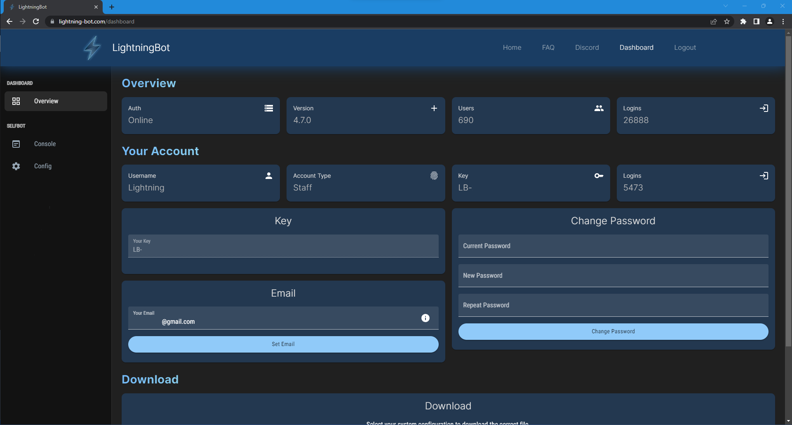
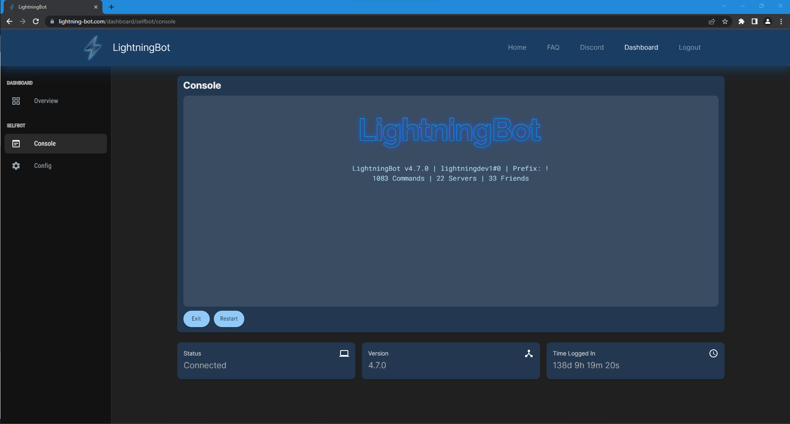
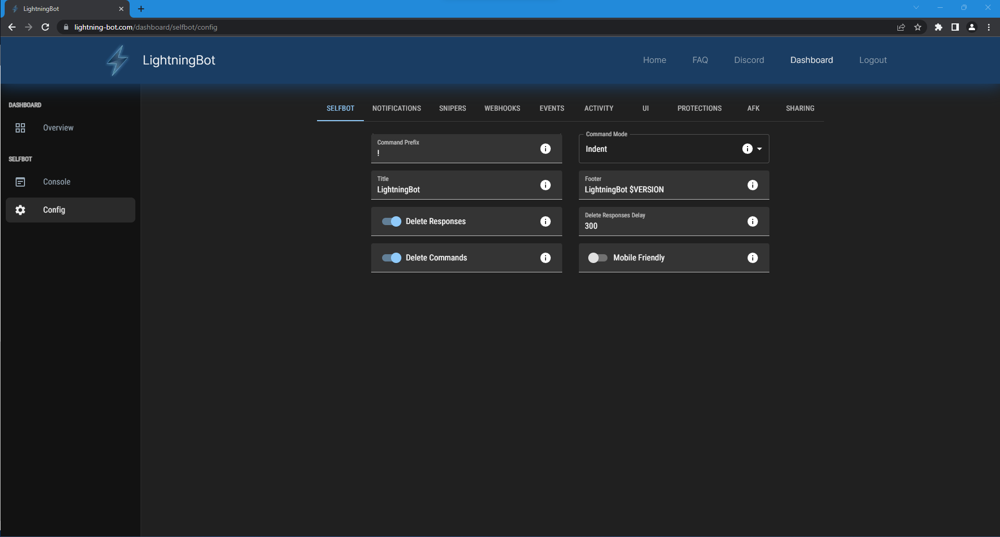

# Web Dashboard

[The Dashboard](https://lightning-bot.com/dashboard) is the place where you can manage and view your account details. You can change your email and password, redeem or buy a key, and download LightningBot.

## Console

If you have LightningBot running, you can also view the console output right from the dashboard. This is possible on any device and on any connection, so you can view the console even without access to the device running LightningBot.

## Config

You can also change the configuration settings from the Dashboard. Just like the console, this is possible even without access to the device running LightningBot. Any changes to the config will be automatically synced to the device running LightningBot.

