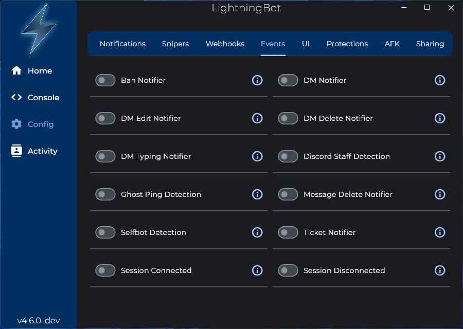

# Events

In the Events tab in the configuration settings, you will find a few toggles that allow you to enable or disable certain event notifications:

If the toggle for a certain event is enabled, you will get a notification when that event occurs. For more details about an event, click the information icon next to the event name.