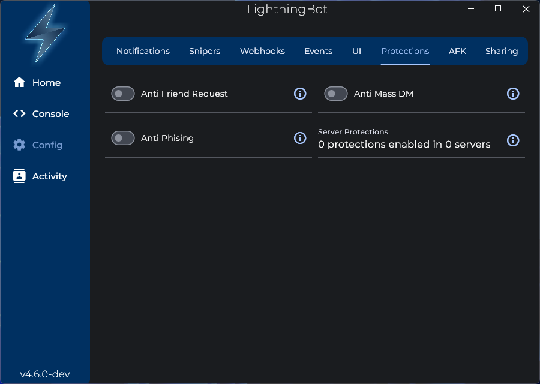

# Protections

The protections can be used to protect your account and servers from malicious users.

## Account Protections

- **Anti Friend Request**: Block friend requests from unknown users when you are being spammed with friend requests.
- **Anti Mass DM**: Block Direct Messages from unknown users when you are being spammed with DMs.
- **Anti Phishing**: Get notified when a user sends a messsage with a known phising link.

## Server Protections

- **Anti Delete**: Get notified when a user deletes a message in your server.
- **Anti Invite**: Block users from sending invite links in your server.
- **Anti Spam**: Block users from spamming messages in your server.
- **Anti Upper**: Block users from sending messages with too many uppercase letters in your server.

You can also configure the protections using commands. Check out the [Protection Commands](/commands/protection-commands) page for more information.