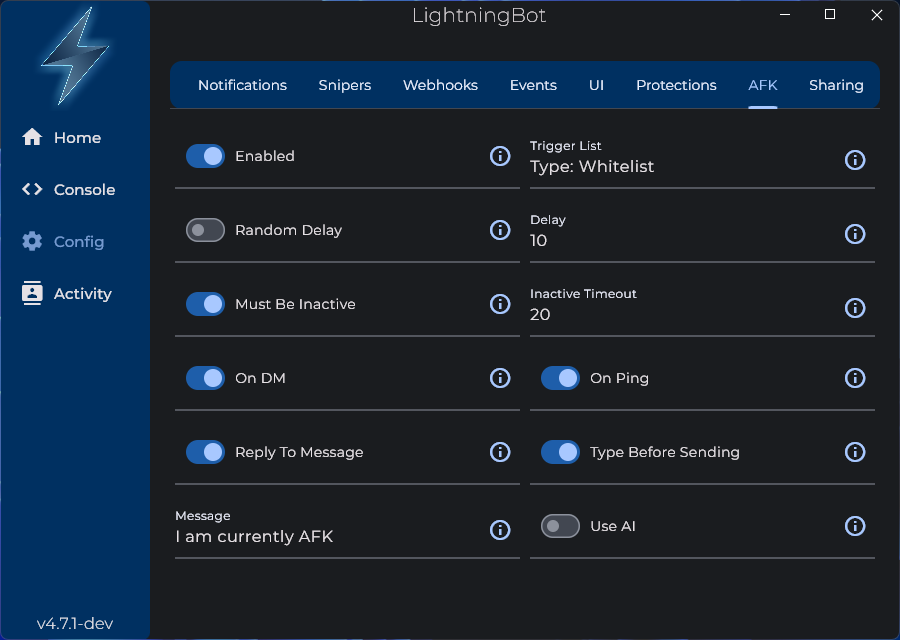

# AFK Mode

The AFK mode can be used to let people that message or mention you to know that you're away. There are a couple of settings you can configure:

- **Enabled**: Whether to enable the AFK mode.

- **Trigger List**: The trigger list defines when the AFK mode should be activated or triggered. There are three modes: Global, Whitelist, and Blacklist. In Global mode, the AFK mode will be triggered for all messages. In Whitelist mode, the AFK mode will only be triggered for users and servers that you have explicitly added to the trigger list. In Blacklist mode, the AFK mode will be triggered for all messages except for users and servers that you have explicitly added to the trigger list.

- **Random Delay**: Whether the time before sending the AFK message should be random. If enabled, the maximum delay will be the value of the **Delay** setting.

- **Delay**: The amount of time to wait before the AFK message is sent when you get a DM or get mentioned.

- **Must Be Inactive/Inactive Timeout**: If enabled, the AFK mode will only activate when your Discord account has not been active. The timeout is the amount of time to wait before the AFK mode is activated.

- **On DM/On Ping**: Whether to send the AFK message when you get a DM and/or get mentioned. At least one of these must be enabled for the AFK mode to work.

- **Reply To Message**: Whether to reply to the message that triggered the AFK mode.

- **Type Before Sending**: Whether to show a `User is typing...` notification in Discord before sending the AFK message.

- **Message**: The message that will be sent when the AFK mode is triggered. You can use the following variables in the message:

  | Variable      | Description                                              |
  | ------------- | -------------------------------------------------------- |
  | `$USER`       | The user that triggered the AFK mode.                    |
  | `$MENTION`    | The mention of the user that triggered the AFK mode.     |
  | `$MSGLINK`    | The link to the message that triggered the AFK mode.     |
  | `$MSGCONTENT` | The content of the message that triggered the AFK mode.  |
  | `$AFKSINCE`   | The time since you have been AFK as a Discord timestamp. |

  For example, you could set the message to `Sorry $MENTION, I have been AFK for $AFKSINCE.`

  See the [Variables](/features/variables) page for more information about dynamic variables.

- **Use AI**: Whether to use AI to generate the AFK message. If enabled, the **Message** setting will be used as the prompt for the AI. It can be left blank for a default prompt.
