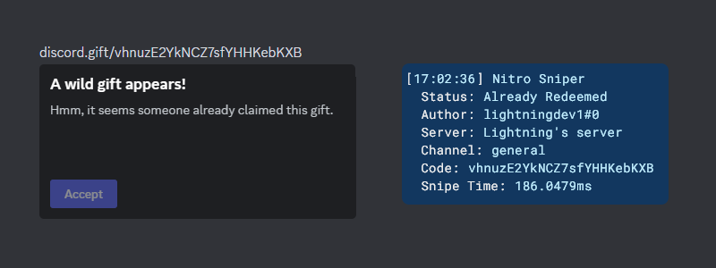
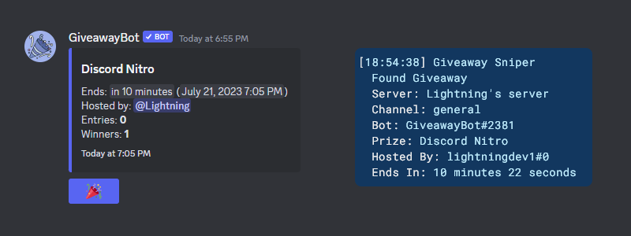
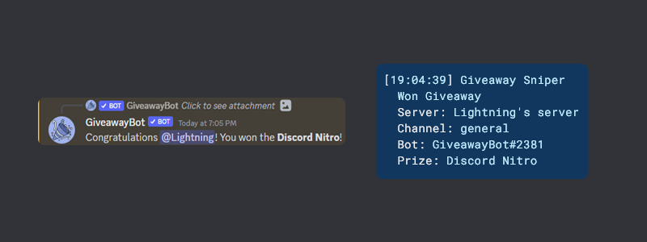

# Snipers

## Nitro Sniper

The nitro sniper will automatically claim nitro gifts sent in any channel you can access.

## Giveaway Sniper

The giveaway sniper will automatically enter giveaways sent in any channel you can access.

You will also get a notification when you win a giveaway:

In the configuration settings, you can change a couple of settings for the giveaway sniper:

- **Giveaway Sniper Sleep** - The amount of time to wait before entering a giveaway after it is sent. This is to prevent you from getting banned from a server for entering giveaways too quickly.

- **Blacklist** - A list of words that, if found in the giveaway prize, will prevent the sniper from entering the giveaway.

- **Server Blacklist** - A list of server IDs that the sniper will not enter giveaways in. This list is also used by the nitro sniper.

### Custom Bots

You can also configure the giveaway sniper to enter giveaways sent by custom bots. To do this, you need to add the bot's ID to the **Custom Bots** list. You can find the bot's ID by enabling developer mode in Discord and right clicking on the bot's name.

## Multi-Token Sniper

The multi-token sniper allows you to use multiple Discord accounts to snipe nitro gifts and giveaways. To do this, add the tokens of the accounts you want to use to the **Tokens** list in the config. You must restart the bot for changes to this list to take effect.