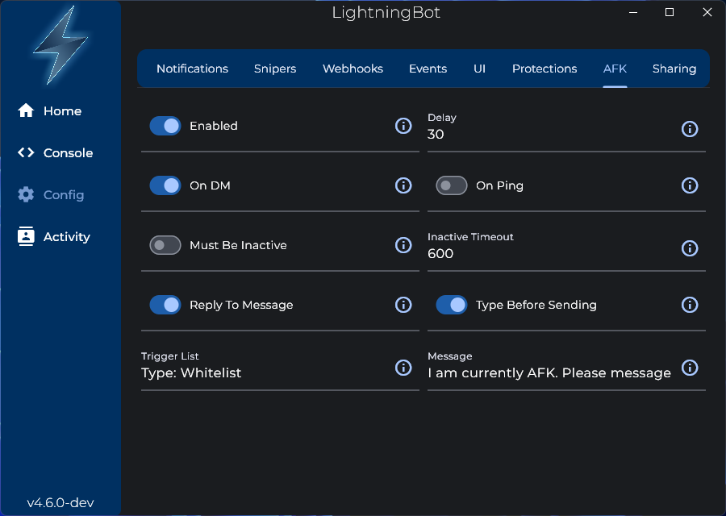

# AFK Mode

The AFK mode can be used to let people that message or mention you to know that you're away. There are a couple of settings you can configure:

- **Delay**: The amount of time to wait before the AFK message is sent when you get a DM or get mentioned.

- **On DM/On Ping**: Whether to send the AFK message when you get a DM and/or get mentioned. At least one of these must be enabled for the AFK mode to work.

- **Must Be Inactive/Inactive Timeout**: If enabled, the AFK mode will only activate when your computer has not been used. The timeout is the amount of time to wait before the AFK mode is activated. Only works on Windows.

- **Reply To Message**: Whether to reply to the message that triggered the AFK mode.

- **Type Before Sending**: Whether to show a `User is typing...` notification in Discord before sending the AFK message.

- **Trigger List**: The trigger list defines when the AFK mode should be activated or triggered. There are three modes: Global, Whitelist, and Blacklist. In Global mode, the AFK mode will be triggered for all messages. In Whitelist mode, the AFK mode will only be triggered for users and servers that you have explicitly added to the trigger list. In Blacklist mode, the AFK mode will be triggered for all messages except for users and servers that you have explicitly added to the trigger list.

- **Message**: The message that will be sent when the AFK mode is triggered.