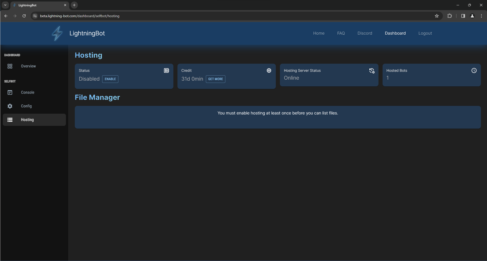
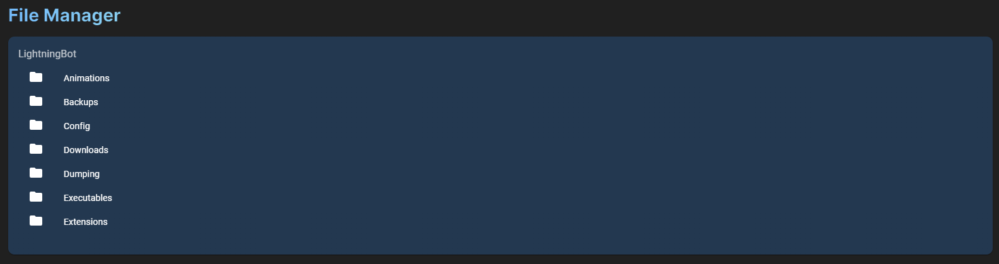

# Hosting

Hosting is a service that allows you to run LightningBot in the cloud on our servers. This eliminates the need to run LightningBot on your own computer. You can use the dashboard to manage your hosted bot, including viewing the console output and changing the configuration settings.

:::warning
Hosting is currently in beta. This means that there are still some bugs and that the service is not yet fully optimized. If you encounter any issues, please report them on [our Discord](https://lightning-bot.com/discord).
:::

## Hosting Dashboard

On the dashboard, you can find the [Hosting](https://lightning-bot.com/dashboard/selfbot/hosting) section in the sidebar. The hosting dashboard is illustrated below:

## Hosting Credit

Hosting credit is the amount of time that you have left on your hosting plan. As a new user, you will be given a free 1-month credit. You can also purchase more credit from the hosting dashboard by clicking the `Get More` button. You will be greeted with a popup that will allow you to purchase more credit. If you already have a hosting key, because you have purchased one from a reseller or received one from a giveaway for example, you can also redeem it in this popup.

## Using Hosting

To enable hosting, simply press the `Enable` button. You will be greeted with a popup that will ask you for your Discord token. You can find your Discord token by following the instructions [here](/getting-your-token). After you have entered your token, it will take around a minute for your bot to start. When your bot has started, you will be able to see the console output and change the configuration like usual on the dashboard (see [here](/features/web-dashboard) for more information about the dashboard). You can also disable hosting by pressing the `Disable` button. This will stop your bot on our servers.

View the [Commands](/category/commands) or [Features](/category/features) pages to learn more about what you can do with LightningBot.

## File Manager

The file manager allows you to view the files that are stored on the server. You can also download and delete files from the file manager. The file manager is illustrated below:

In the file manager, you can interact with directories and files as follows:

- Clicking on a directory will open it.
- Right-clicking on a directory will open a context menu that allows you to delete the directory.
- Clicking on a file will download it.
- Right-clicking on a file will open a context menu that allows you to download or delete the file.

## Troubleshooting

If you are having issues with hosting, you can try the following:

- Restart your bot by disabling and enabling hosting again. Make sure that you have entered your token correctly.
- Check the console output for any errors.
- If you are still having issues, you can contact us on [our Discord](https://lightning-bot.com/discord). Check out the [Support](/category/support) page for more information about support.
